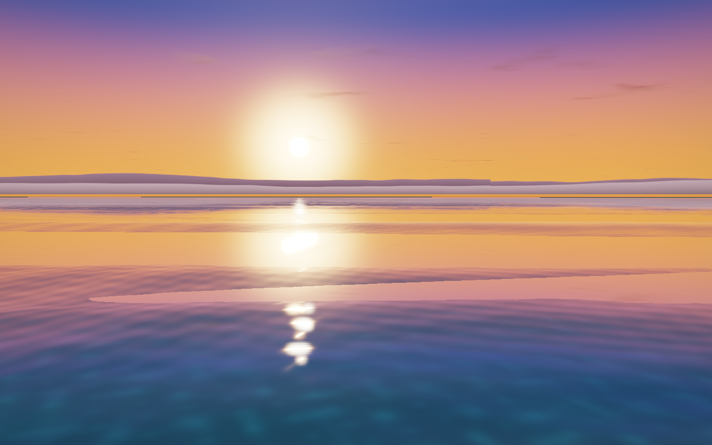

<div align="center">

# Azure Water

**A little ocean. A lot of atmosphere.**

Real-time water in Python, with rolling waves, reflected sunsets, and a procedural sky.

[Quick start](#quick-start) · [Controls](#controls) · [Under the surface](#under-the-surface) · [MIT license](LICENSE)

</div>



<p align="center"><em>Golden hour, rendered live. Calm preset · 5° sun elevation · 0.9 exposure.</em></p>

Azure Water is a compact, interactive ocean renderer built with **Python, ModernGL, and GLFW**. Drift across the surface, follow the sun, or turn a gentle swell into a storm. The sky, waves, foam, and seabed are generated procedurally—no external texture assets needed.

## What makes it shine

- **Water with motion and depth.** Eight Gerstner wave components, analytic surface normals, fine ripples, and crest foam.
- **Light that follows the view.** Planar sky reflections, Fresnel blending, sun specular, and depth-aware refraction with water absorption.
- **An entire atmosphere.** A procedural sky with a sun disc, drifting clouds, distant mountain silhouettes, and a sandy seabed with animated caustics.
- **A cinematic finish.** HDR rendering, bloom, ACES tone mapping, vignette, and dithering.
- **Room to experiment.** Three sea states, an orbit camera, live sunlight and exposure controls, and built-in screenshot capture.

## Quick start

You'll need **Python 3.10+**, a desktop display, and a GPU/driver supporting **OpenGL 3.3 core or newer**. Developed with Python 3.14; the screenshot above was captured on an Apple M1 Pro with OpenGL 4.1.

```sh
git clone https://github.com/mindacrobatic/azure-water.git
cd azure-water
python3 -m venv .venv
source .venv/bin/activate
python -m pip install -r requirements.txt
python main.py
```

On Windows, create the environment with `python -m venv .venv` and activate it with `.venv\Scripts\Activate.ps1` in PowerShell, then run the same install and launch commands.

The default scene opens at sunset with the **Breeze** preset. Drag to look around, scroll to zoom, and press **1**, **2**, or **3** to change the sea. The window title shows the current preset, sun elevation, exposure, and frame rate.

## Choose your sea

| Preset | Feel | Launch |
| --- | --- | --- |
| **Calm** | Gentle, glassy swell without crest foam | `python main.py --waves calm` |
| **Breeze** | Rolling waves with scattered whitecaps | `python main.py --waves breeze` |
| **Storm** | Larger cross seas with heavy crest foam | `python main.py --waves storm` |

Try a brighter daytime scene:

```sh
python main.py --waves breeze --sun-elev 35 --exposure 1.0
```

## Controls

| Action | Key / gesture |
| --- | --- |
| Orbit | Left mouse drag |
| Zoom | Mouse wheel |
| Move forward / left / back / right | `W` / `A` / `S` / `D` |
| Move up / down | `E` / `Q` |
| Move faster | Hold `Shift` while moving |
| Calm / Breeze / Storm | `1` / `2` / `3` |
| Lower / raise the sun | `,` / `.` |
| Pause / resume animation | `Space` |
| Save a screenshot | `P` |
| Reset camera | `R` |
| Quit | `Esc` |

Exposure controls depend on the keyboard layout because GLFW uses US physical key positions:

| Action | German Mac labels | US labels |
| --- | --- | --- |
| Decrease exposure | `-` or `ß` | `/` or `-` |
| Increase exposure | `+` or `´` | `]` or `=` |
| Alternative key to lower the sun | `ü` | `[` |

## Capture a moment

Press **P** to save a PNG to `screenshots/azure_<timestamp>.png`, or render a fixed number of frames and save the final one:

```sh
python main.py --size 1440x900 --waves calm --sun-elev 5 --exposure 0.9 \
  --frames 60 --shot screenshots/golden-hour.png
```

This is the recipe used for the README image. Fixed-frame captures advance the simulation at 1/60 second per frame and exit automatically. They still require a working display and OpenGL context. Image dimensions follow the actual framebuffer, which may be larger than the requested window on high-DPI displays.

Personal captures in `screenshots/` are ignored by Git; the README image lives in `docs/images/` so it is included in the repository.

<details>
<summary><strong>All command-line options</strong></summary>

| Option | Default | Purpose |
| --- | --- | --- |
| `--size WxH` | `1280x800` | Window dimensions |
| `--waves calm\|breeze\|storm` | `breeze` | Initial sea state |
| `--sun-elev DEG` | `5` | Sun elevation in degrees |
| `--sun-az DEG` | `200` | Sun azimuth in degrees |
| `--exposure F` | `1.0` | Initial exposure |
| `--no-vsync` | Disabled | Remove vertical synchronization |
| `--frames N` | Unset | Render N fixed time steps, capture, then exit |
| `--shot PATH` | Timestamped PNG in `screenshots/` | Destination for a screenshot |

`--shot` sets the destination; use `--frames` or press **P** to trigger capture. Run `python main.py --help` for the CLI reference.

</details>

## Under the surface

The renderer builds each frame in five stages:

1. **Reflection:** render the procedural sky from a mirrored camera into a half-resolution buffer.
2. **Scene:** render the sky and sandy seabed into color and depth textures.
3. **Water:** displace a grid with Gerstner waves, then combine reflection, refraction, absorption, sun highlights, and foam.
4. **Bloom:** extract bright areas and blur them horizontally and vertically at half resolution.
5. **Composite:** combine HDR color and bloom, apply ACES tone mapping, then finish with vignette, dithering, and gamma correction.

The water grid concentrates vertices near the camera. Distant waves fade with level of detail, while near-camera flattening helps keep the surface out of the view.

| File | What to explore |
| --- | --- |
| [`main.py`](main.py) | Window, keyboard and mouse input, frame loop, screenshots |
| [`water/camera.py`](water/camera.py) | Orbit camera and matrix helpers |
| [`water/renderer.py`](water/renderer.py) | Render passes, wave presets, lighting palettes, GPU resources |
| [`water/shaders/`](water/shaders/) | GLSL shaders for sky, water, seabed, and post-processing |

To tune the sea states, start with `PRESETS` in `water/renderer.py`: amplitude, steepness, foam, surface detail, roughness, and directional spread are all exposed there.

### Inspect the render buffers

Use `AZURE_DEBUG` to view intermediate output:

```sh
AZURE_DEBUG=refl python main.py   # Planar reflection
AZURE_DEBUG=scene python main.py  # Sky and seabed
AZURE_DEBUG=hdr python main.py    # HDR before bloom
```

These examples use a POSIX shell. In PowerShell, set `$env:AZURE_DEBUG = "refl"` before launching. Add `--frames 60 --shot screenshots/debug.png` to capture a buffer.

If the window cannot open, check that a desktop display and an OpenGL-capable driver are available. For a lighter rendering workload, try `--size 960x600`.

## License

[MIT](LICENSE) · Copyright © 2026 mindacrobatic.
